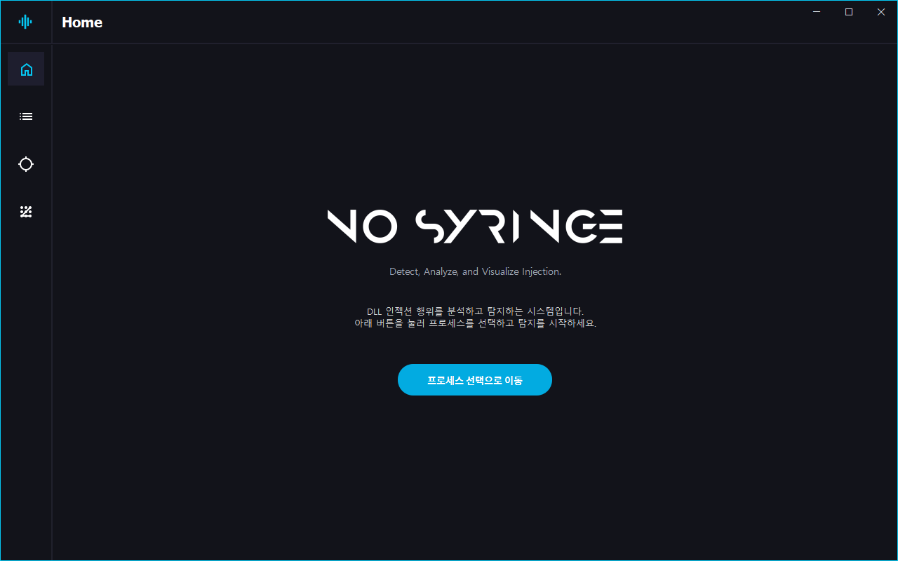
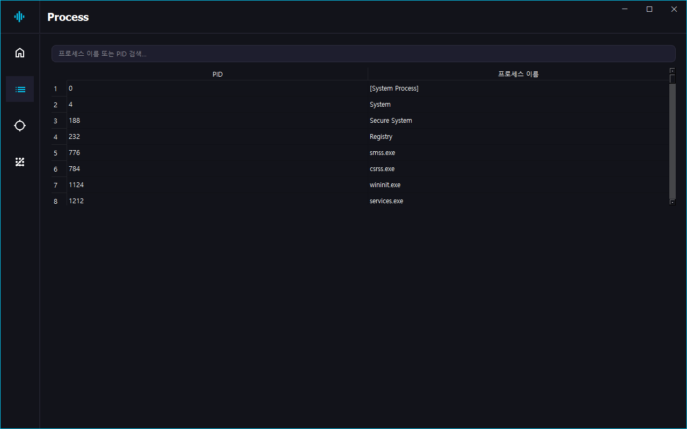
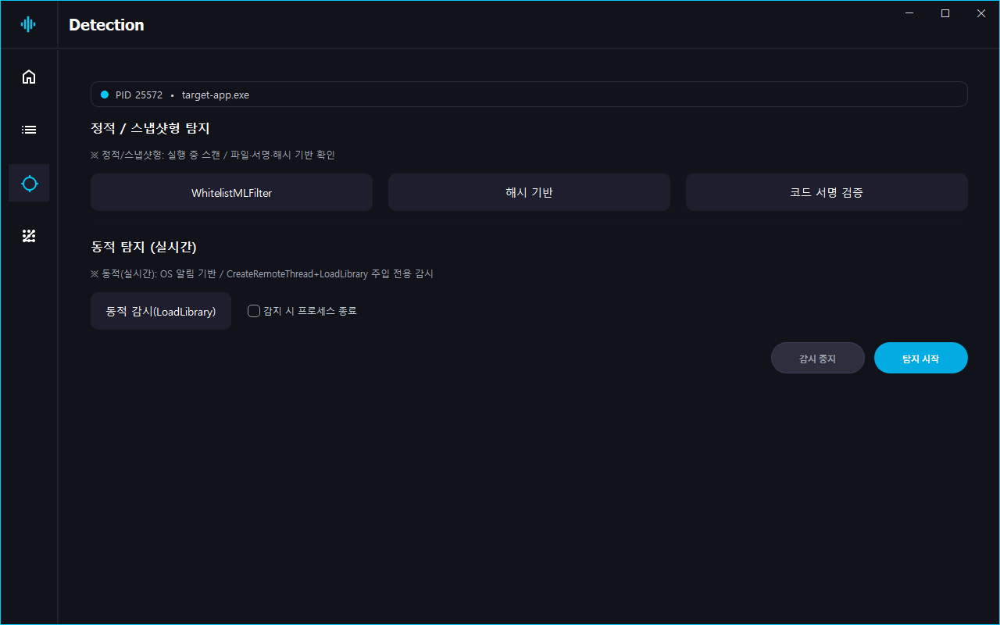
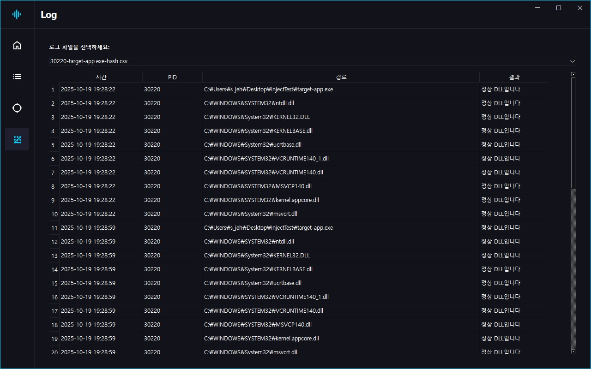
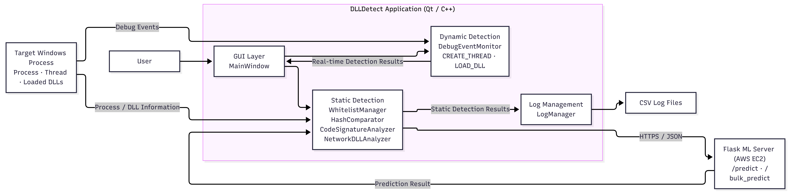

# DLLDetect

> **Detect, Analyze, and Visualize Injection**  
> Windows 환경에서 DLL 인젝션의 원리와 탐지 기법을 학습하기 위해 개발된 **학습용 보안 프로젝트**입니다.  
> 인젝션 행위를 실험적으로 탐지·분석하고, 그 과정을 **직관적인 GUI**로 시각화하는 것을 목표로 합니다.

---

## 목차
- [프로젝트 소개](#프로젝트-소개)
- [주요 기능](#주요-기능)
- [GUI 미리보기](#gui-미리보기)
- [시스템 아키텍처](#시스템-아키텍처)
- [모듈 구성](#모듈-구성)
- [개발 환경](#개발-환경)
- [디렉터리 구조](#디렉터리-구조)
- [로그 및 결과물](#로그-및-결과물)
- [향후 계획](#향후-계획)
- [면책 조항](#면책-조항)

---

## 프로젝트 소개

**DLLDetect**는 DLL 인젝션의 동작 원리와 탐지 과정을 학습하기 위한 프로젝트입니다.  
Windows 환경에서 **정적 탐지(Static Detection)** 와 **동적 탐지(Dynamic Detection)** 를 실험적으로 구현하였으며,  
탐지 결과를 **Qt 기반 GUI**를 통해 시각적으로 확인할 수 있도록 구성했습니다.

### 탐지 방식
1. **정적 탐지 (Static Detection)**
   - 해시 검증
   - 코드 서명 검증
   - 화이트리스트 및 ML 기반 필터링

2. **동적 탐지 (Dynamic Detection)**
   - 디버그 이벤트 기반 행위 감시
   - `CreateRemoteThread` / `LoadLibrary` 관련 이벤트 추적

> **정적 탐지 결과는 CSV 로그로 저장**되며,  
> **동적 탐지 결과는 GUI 상에서 실시간으로 확인**할 수 있습니다.

---

## 주요 기능

| 구분 | 기능 | 설명 |
|------|------|------|
| 정적 | **화이트리스트 + ML 필터링** | 화이트리스트 등록 여부를 우선 확인하고, 미등록 DLL은 원격 ML 서버에 전송하여 정상/비정상 여부를 판정 |
| 정적 | **해시 기반 무결성 검증** | SHA-256 해시 비교를 통해 DLL 변조 및 비인가 로드 여부 확인 |
| 정적 | **코드 서명 검증** | `WinVerifyTrust` API를 사용하여 서명의 유효성을 검증 |
| 동적 | **디버그 이벤트 모니터링** | `CreateRemoteThread` / `LoadLibrary` 이벤트 감시를 통해 인젝션 행위를 탐지 |
| 로깅 | **CSV 로그 관리** | 정적 탐지 결과를 CSV 파일로 저장 |
| 시각화 | **로그 뷰어** | 저장된 CSV 로그를 테이블 형태로 조회 가능 |
| GUI | **Qt 기반 인터페이스** | 프로세스 선택, 탐지 실행, 결과 시각화, 로그 확인 기능 제공 |

---

## GUI 미리보기

### 홈 화면


- 프로젝트 소개 및 탐지 시작 진입점

### 프로세스 선택 화면


- 현재 실행 중인 프로세스 목록 표시
- 대상 프로세스 선택 및 DLL 목록 확인

### 탐지 화면


- 정적/동적 탐지 실행
- 탐지 결과 실시간 표시
- 로그 저장 및 결과 확인

### 로그 스테이지 화면


- 정적 탐지 후 생성된 CSV 로그를 GUI에서 테이블 형태로 조회

---

## 시스템 아키텍처

<p align="center">
  
</p>

### 아키텍처 설명
- **GUI 모듈**은 사용자 입력을 받아 탐지 기능을 실행하고 결과를 표시합니다.
- **탐지 모듈**은 정적/동적 분석을 수행합니다.
- **로그 관리 모듈**은 정적 탐지 결과를 CSV 형태로 저장하고 조회합니다.
- 현재는 **동일 프로세스 내 함수 호출 방식**으로 연동되며, 추후 필요 시 **IPC 구조**로 확장할 수 있습니다.

---

## 모듈 구성

### 1) GUI 모듈 (`gui/`)
#### MainWindow
- 프로세스 목록 로드 및 대상 선택
- 탐지 방식 실행 제어
- 선택된 프로세스의 DLL 목록 표시
- 탐지 결과 및 로그 화면 표시

> **정책:** GUI에서는 한 번에 하나의 탐지만 실행되도록 제한합니다.  
> 하나의 출력 영역을 기준으로 동작하므로, 탐지 중 중복 실행을 방지합니다.

---

### 2) 화이트리스트 + ML 필터링 모듈
#### WhitelistManager
- `whitelist.txt` 로드
- DLL 파일명 기준(대소문자 무시) 화이트리스트 판별

#### NetworkDLLAnalyzer
- 화이트리스트에 없는 DLL을 원격 서버로 전송하여 분석 요청
- 단건 요청: `/predict`
- 배치 요청: `/bulk_predict`
- DLL 파일을 Base64로 인코딩 후 JSON POST 전송
- 분석 결과(`예측값`, `출처`)를 `analysisFinished()` 시그널로 GUI에 전달

---

### 3) 정적 탐지 모듈 (`Static Detection`)
#### HashComparator
- SHA-256 해시 계산
- 기준 해시 목록과 비교하여 무결성 검증 수행

#### CodeSignatureAnalyzer
- `WinVerifyTrust` 기반 코드 서명 검증 수행
- 서명이 없거나 신뢰되지 않은 경우 의심 대상으로 분류

> **정적 탐지의 목적**은 DLL의 **무결성**과 **신뢰성**을 확인하는 것입니다.  
> 모든 정적 탐지 결과는 CSV 로그로 저장됩니다.

---

### 4) 동적 탐지 모듈 (`Dynamic Detection`)
#### DebugEventMonitor
- `DebugActiveProcess`를 사용하여 지정 PID의 디버그 이벤트 수신
- `CREATE_THREAD`, `LOAD_DLL` 이벤트 감시
- 스레드 생성 후 DLL 로드 여부를 연관 분석
- 경로 위험도(Temp, Downloads 등) 및 이벤트 링크 여부를 바탕으로 점수 계산
- 일정 점수 이상일 경우 `alert` 시그널 발생
- `autoKill` 모드에서는 `TerminateProcess()` 호출 가능

> **동적 탐지의 목적**은 인젝션과 관련된 **행위 기반 이벤트를 실시간으로 감시**하는 것입니다.  
> 동적 탐지 결과는 파일로 저장하지 않고 GUI에 실시간 표시됩니다.

---

### 5) 로그 관리 모듈
#### LogManager
- 정적 탐지 결과를 CSV 형식으로 저장
- 파일명 예시: `1234-GameClient-Static.csv`
- 컬럼:
  - `timestamp`
  - `PID`
  - `dll_path`
  - `result`

#### LogViewerWidget
- 저장된 CSV 로그 파일을 읽어 테이블 형태로 표시

> **로그 정책**
> - 정적 탐지 결과: **CSV 저장**
> - 동적 탐지 결과: **실시간 GUI 표시 전용**

---

## 개발 환경

| 항목 | 내용 |
|------|------|
| 언어 | C++17 |
| 프레임워크 | Qt 6.9.x |
| 빌드 시스템 | CMake + Ninja |
| 툴체인 | MinGW-w64 64bit |
| 운영체제 | Windows 10 / 11 |
| 외부 연동 | Flask ML 서버 (AWS EC2 환경) |

---

## 디렉터리 구조

```text
DLLDetect/
├── gui/                              # Qt GUI (메인 윈도우)
│   ├── mainwindow.cpp
│   ├── mainwindow.h
│   └── mainwindow.ui
├── include/                          # 공용 헤더(프로젝트 전역)
├── resources/                        # 아이콘/이미지/QSS 등 리소스(qrc 연동)
├── src/                              # 핵심 로직
│   ├── CodeSignatureAnalyzer.cpp     # 코드 서명 검증 (WinVerifyTrust)
│   ├── DebugEventMonitor.cpp         # 동적 탐지 (디버그 이벤트 기반)
│   ├── DLLAnalyzer.cpp               # DLL 정보 출력
│   ├── HashComparator.cpp            # SHA-256 해시 계산 및 비교
│   ├── logmanager.cpp                # 정적 탐지 결과 CSV 로그 저장
│   ├── LogViewerWidget.cpp           # CSV 로그 뷰어
│   ├── NetworkDLLAnalyzer.cpp        # 원격 ML 분석 요청
│   ├── ProcessManager.cpp            # 프로세스 스캔/결과 집계
│   ├── Result.cpp                    # 결과 구조체 구현
│   └── WhitelistManager.cpp          # 화이트리스트 로드/판정
├── tools/                            # Flask 서버 / ML 관련 스크립트
├── .gitignore
├── appicon.rc                        # Windows 리소스(아이콘)
├── CMakeLists.txt
├── main.cpp                          # 엔트리 포인트
└── README.md
```

## 로그 및 결과물

탐지 결과는 **CSV 로그 파일**과 **GUI 로그 뷰어**를 통해 확인할 수 있습니다.

### 정적 탐지 결과

* 로그 파일은 **데스크톱 경로**에 자동 저장됩니다.
* 파일명 예시: `1234-GameClient-Static.csv`
* 컬럼 구성:

  * `timestamp`
  * `PID`
  * `dll_path`
  * `result`
* CSV 파일은 GUI의 **로그 스테이지**에서도 바로 확인할 수 있습니다.

### 동적 탐지 결과

* 실시간으로 GUI 탐지 스테이지에 표시됩니다.
* 별도의 파일로 저장되지 않습니다.
* 탐지 이벤트 발생 시 경고 알림 및 로그 메시지가 출력됩니다.

> **참고:** 로그 파일은 탐지 실행 시 자동으로 새로 생성되며,
> 동일한 프로세스에 대해 다시 탐지하더라도 이전 로그를 덮어쓰지 않고 별도로 저장합니다.

---

## 향후 계획

* **KMDF 커널 드라이버 기반 탐지 확장**
* **머신러닝 모델 고도화 및 데이터셋 확충**
* **클라우드 로그 동기화 및 중앙 관리 기능**
* **아키텍처 분리 및 IPC 기반 확장 구조 검토**

---

## 면책 조항

> 본 프로젝트는 DLL 인젝션 및 탐지 기법에 대한 학습·연구 목적으로 개발되었습니다.
> 프로젝트의 코드와 기술 정보는 교육 및 보안 연구를 위한 것이며, 허가되지 않은 시스템에 대한 공격적 사용을 의도하지 않습니다.
> 구현된 기능의 완전한 탐지 성능과 안정성을 보장하지 않으며, 사용에 따른 책임은 사용자에게 있습니다.
